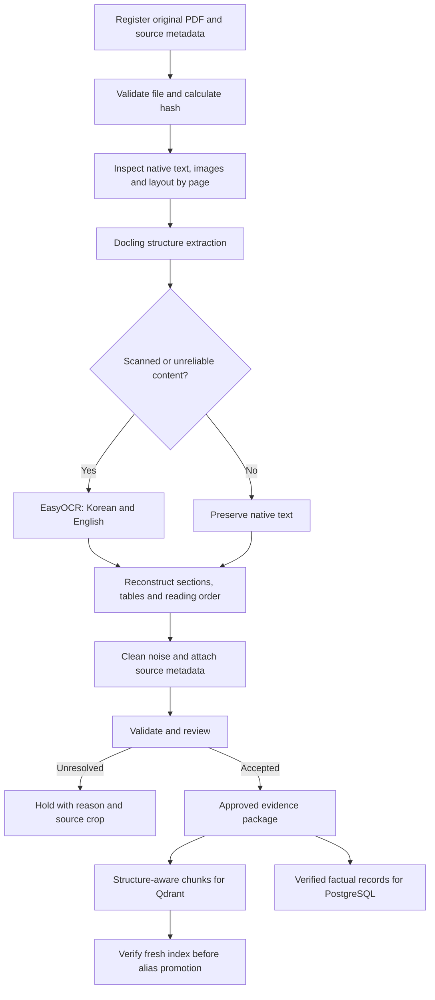

# Improvement #3: Redesign the document ingestion pipeline

**Status: implementation instructions; not completed.** Prepared on 2026-10-27. Start with **Docling + EasyOCR configured for Korean and English**. Validate locally before moving the worker to AWS, which remains the project's deployment direction.

The purpose is to turn source documents into traceable, correctly structured evidence. A successful run must preserve amounts, dates, degree markers, table relationships and exceptions. Producing readable Markdown alone is not enough.

## What already exists

| Component | What it does today | What is still missing |
|---|---|---|
| [extract_pdfs.py](../backend/extract_pdfs.py) | Extracts native PDF page text into `data/extracted.json`, including filename and page number | Pages with no text are skipped after a warning; there is no connected OCR fallback or quality report |
| [index_documents.py](../backend/index_documents.py) | Chunks text by character count and embeds it into `randyll_korea_test` | It loses section/table boundaries, uses random IDs, and deletes/recreates that test collection |
| [test_ocr.py](../backend/test_ocr.py) | Runs Docling with OCR and table extraction enabled on two named PDFs; exports Markdown | It does not explicitly configure EasyOCR with Korean/English, select failed regions, preserve a review manifest, or validate extraction correctness |
| Prepared topic package | Supplies topic TXT files used by the earlier knowledge loader | A complete, repeatable generator from raw PDFs to this package was not found in the inspected code |

The recent polishing work added [review_knowledge.py](../backend/review_knowledge.py), pinned source hashes, checked section plans, held-content controls and verified index promotion. Those corrections are a foundation and a source of benchmark examples. They are not the interns' completed general-purpose ingestion pipeline.

Read [the knowledge-review implementation](knowledge-review-implementation.md) before changing ingestion. Preserve its corrected evidence, original archives and review history.

## Selected starting approach

Use Docling for document structure and table reconstruction, with EasyOCR explicitly selected for Korean and English recognition. Docling supports selectable OCR engines and table extraction options; EasyOCR supports language combinations including English alongside other supported languages. Configure EasyOCR's language codes as `ko` and `en`, and verify them in the pinned integration. [Docling OCR documentation](https://github.com/docling-project/docling/blob/main/docs/concepts/OCR.md), [EasyOCR documentation](https://github.com/JaidedAI/EasyOCR).

Keep reliable native PDF text. Use OCR for scanned content or text layers that fail inspection. Do not assume that a page needs no OCR merely because it contains a page number or a short heading.

Docling also exposes table-cell matching options that can be evaluated when columns merge incorrectly. Treat any setting change as an experiment on the benchmark, not an automatic improvement. [Docling advanced options](https://docling-project.github.io/docling/usage/advanced_options/).

This selection establishes the first baseline. It does not claim that OCR or table accuracy has already been measured on this corpus.

## Intended flow

The PostgreSQL destination depends on Improvement #2's schema and import work. Keep extracted facts as staged records until that interface exists; do not invent database tables or silently write unreviewed values into the live database.

## Instructions for the interns

### 1. Prepare a small benchmark before changing the pipeline

Select 20–30 representative pages. Include native English text, Korean text, mixed-language pages, genuine scans, multi-column layouts, merged tables, forms and continuation tables. Include low-quality scans where available. Do not call a native-text-only sample an OCR benchmark.

Use the repaired Hannam pages as regression examples:

- Graduate guide, physical pages 4–5: degree markers, merged discipline groups, continuation headings and separate Biopharmaceutical Engineering entries.
- Undergraduate guide, page 20: all 41 GPA rows and the inclusive lower-bound wording.
- Undergraduate guide, pages 10–11: dated country and school appendices.
- Undergraduate guide, pages 16–19: form instructions, declarations and empty fields.

Add scholarship, tuition and admission-timetable pages from the other guides. Have a reviewer prepare expected text and cell relationships directly from the rendered source. Existing corrected records can help, but must not be the only ground truth.

Record each source hash, physical page number, expected fields and known difficulty. Synthetic scans may supplement the sample; label them separately from real scanned documents.

### 2. Make the experiment reproducible

Use a separate development environment so OCR dependencies do not disrupt the working chatbot. Install Docling and EasyOCR using their documented installation requirements. Record and pin the tested Python, package, model and PyTorch versions, together with the CPU/GPU configuration. Check compatible PyTorch/CUDA installation before enabling GPU execution on Windows.

Replace the hardcoded two-file loop with a configurable input list and output location. Configure the OCR engine and languages explicitly rather than relying on automatic defaults. Record table settings, OCR settings and model identifiers in every run report. Download model assets during setup and make their cache location explicit so subsequent runs can be reproduced.

Start with normal native-text handling and selective OCR. Implement a separate retry mode for pages whose existing text layer is unusable; record why that retry forced OCR. Do not force OCR over the entire corpus without measuring its effect.

### 3. Register and validate the sources

For each document, record a stable source ID, original filename, SHA-256 hash, institution, document type, language, intake/year where stated, source URL where known, acquisition date and review status. Mark unavailable metadata as unknown; do not infer an institution from an ambiguous filename.

Keep originals unchanged. Check that files are readable PDFs, record page counts, detect exact duplicates by hash, and report encrypted, corrupt or unreadable files. Keep changed versions separate from their predecessors. A duplicate hash can avoid repeated parsing without discarding its source-registration history.

Every page must receive a recorded outcome: extracted, intentionally blank, held or failed. A console warning followed by skipping the page is not sufficient.

### 4. Extract text and structure together

Use native text and layout inspection to decide which pages or image regions need OCR. Consider text coverage, suspicious characters, image coverage and reading order; nonempty text alone is not a quality check. Calibrate thresholds against the benchmark rather than choosing one character-count threshold for every document.

Preserve paragraphs, headings, lists, table cells and their source positions. Store machine-readable Docling output as well as Markdown previews. Retain the raw extraction so a cleaning or chunking mistake can be corrected without losing the evidence.

For each table, keep row and column indices, header relationships, merged-cell spans, page references, bounding regions, captions and footnotes. Join tables across pages only when the continuation and column mapping are supported by the source. Otherwise hold the continuation for review.

Keep circles, dashes, blank cells and numeric zero distinct. For example, a dash in a degree column must not become an available program, and a blank fee must not become zero. Preserve untranslated source text alongside any later translation; OCR is not translation or fact verification.

### 5. Clean and normalize without changing meaning

Remove repeated headers, footers and navigation only after identifying their role. Do not remove a table heading or its reference date as “noise.” Exclude standalone blank form fields while retaining instructions and declarations.

Keep exact currency symbols, units, decimal separators, inequality signs, dates and eligibility exceptions. Store the original text alongside normalized values. Do not repair a suspicious fee, date or school name by guessing. Record the issue and send it for review.

### 6. Produce traceable evidence and review records

The proposed output contract should include:

| Group | Required information |
|---|---|
| Identity | Source ID, document version/hash and stable record ID |
| Location | Physical PDF page or page span, section heading and bounding region where available |
| Extraction | Native/OCR/manual method, engine/model versions and configuration hash |
| Scope | Institution, degree, topic/domains, language, applicant audience and applicable year/intake when supported |
| Content | Raw text, cleaned text, table structure and links to supporting notes |
| Review | Status, reasons, reviewer and review date |
| Quality | Available confidence values, validation failures and artifact paths; use null when a score is unavailable |

Separate extraction success from publication approval. High OCR confidence does not prove that a table cell belongs to the correct heading. Keep held/failed material out of both focused and broad retrieval. Map accepted records into the existing production loader's `status=active` and `audience=international` contract only after the relevant checks pass.

Give reviewers a page preview, extracted content, table layout and a clear reason for each flag. Keep corrections linked to the original evidence. Do not automatically release the currently held knowledge files just because a new parser produced output.

### 7. Chunk and publish approved content

Chunk by headings, paragraphs and logical table records. Attach the relevant table headers, units, scope and footnotes to each row or row group. Keep an eligibility condition with its exceptions. If a record exceeds the embedding model's input budget, split it at a meaningful boundary and repeat required context; do not silently truncate it.

Connect the new output through an adapter to the reviewed knowledge manifest. Reuse the existing active/audience gates and fresh-collection verification. Keep candidate ingestion outputs separate until they have passed comparison with the current approved evidence.

Use stable IDs and cache keys derived from source version, extraction configuration and record identity. An unchanged rerun should not create duplicate records. A changed source, parser or model must invalidate the relevant cached output. Reuse embeddings only when the embedding input and model configuration are unchanged. Retire removed records through a new verified snapshot, preserving the previous collection for rollback.

Do not use `index_documents.py` as the production publication command: it is the legacy test indexer. Continue using verified index promotion after the new ingestion adapter is ready.

### 8. Measure the result and hand it over

Report native-text and scanned-page results separately. Measure Korean/English text errors, exact numeric/date/marker accuracy, table-cell alignment, missing rows, header/footnote attachment, processing time, peak memory and manual correction effort. Report engine confidence separately from measured correctness.

For the first accepted benchmark, require every page to be accounted for and all reviewer-designated critical fields in released records to match the source exactly. Any unresolved critical field must remain held. This is an acceptance requirement for the sample, not a claim of perfect corpus-wide accuracy. Record both the accepted coverage and the held rate so an extractor cannot appear successful by withholding everything difficult.

Run meaningful regression checks for merged cells, continuation tables, GPA boundaries, bilingual declarations, corrupt PDFs, scanned pages, duplicate inputs and unchanged reruns. Demonstrate that held content never reaches retrieval and that a failed build leaves the live alias unchanged.

Deliver the implementation, pinned environment, configuration, benchmark manifest, expected outputs, scored results, review queue and a README with exact commands verified on a fresh environment. Include a small distributable fixture set where permitted; the repository's ignored `data/` directory is not a reproducible handover by itself.

## Suggested deliverables

These paths describe work to create; they are not existing runnable commands:

| Proposed artifact | Purpose |
|---|---|
| `backend/ingestion/` | Source validation, parsing, OCR routing, cleaning, normalization and reviewed-output adapter |
| `config/ingestion.json` | Explicit OCR languages, model/table settings, limits and review rules |
| `test/fixtures/ingestion/` | Small permitted fixtures and expected structured results |
| `test/test_ingestion.py` | Regression and failure-handling checks |
| `docs/ingestion-benchmark.md` | Measured results, known failures and tested configuration |
| Per-run artifact directory under `data/` | Source manifests, raw/clean output, page previews, logs and review records |

Keep implementation modular, but avoid introducing an elaborate agent framework. A deterministic worker with explicit stages, resumable jobs and review gates is sufficient for this phase.

## Fit with the AWS roadmap

Validate the same worker locally first, then package it for the AWS architecture described in the technical strategy. Plan for S3 to hold originals, versions and extraction artifacts; a container worker to process jobs; PostgreSQL/RDS to store structured facts and review metadata; and Qdrant to serve approved passages. Queueing and workflow orchestration can follow once the worker's behavior is stable.

Measure CPU/GPU requirements before selecting the AWS compute configuration. Cloud deployment does not replace language testing, table validation or the review process. No AWS resources or services are deployed by this document.

## Completion checklist

- A fresh environment can process the benchmark using documented commands and pinned settings.
- Korean and English OCR is explicitly configured and tested on real scans.
- All pages and failed regions are accounted for; failed work can be retried without duplicating approved records.
- Tables preserve headings, cell relationships, units, markers and continuation context.
- Output retains source evidence, version information, review status and extraction history.
- Critical benchmark fields pass review, and all unresolved records remain held.
- Approved outputs can feed the existing Qdrant publication path and the agreed structured-data staging interface.
- The benchmark report distinguishes measured results from future targets and records remaining manual work.

Until those deliverables are verified, keep Improvement #3 marked **in progress**, even if Docling successfully exports Markdown.
