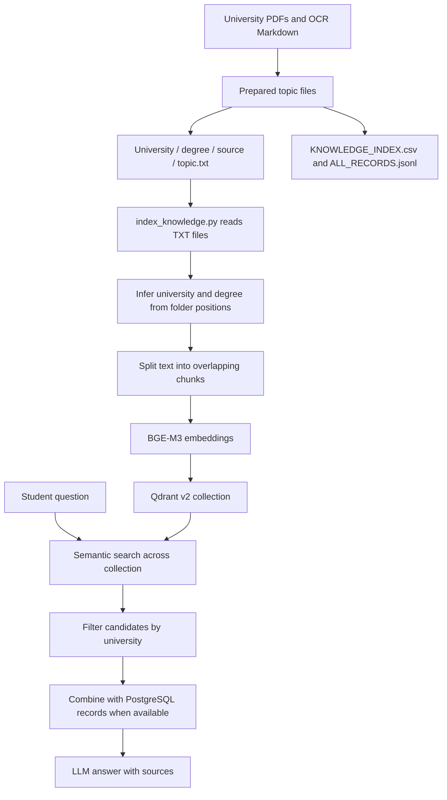
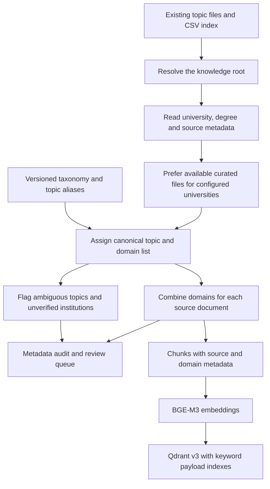
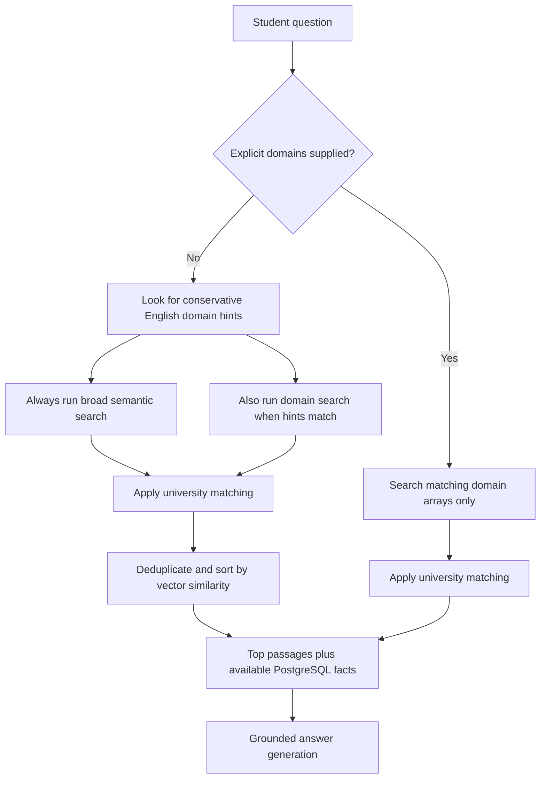

# Organizing the knowledge base by domain

> Current implementation: [Applying the flagged-file review](knowledge-review-implementation.md). The v3 counts and verification below describe the earlier baseline; reviewed snapshots now use an active-content gate and a live alias.

This guide explains how the interns organized the knowledge files, what we changed, and how to maintain the domain classification. It implements Improvement #1 from the technical strategy. A domain is a broad subject such as finances; a topic is a narrower label such as tuition fees.

## How the existing flow worked

The prepared knowledge package contains topic files, a CSV file index, and JSONL passage records. Its README describes the extraction as an automated first pass. The current repository consumes that package; it does not contain a complete, reproducible classifier that generates it from the original PDFs.



The CSV and JSONL files were present, but the indexer read the TXT files and derived their metadata from folder positions. It stored a topic but had no shared domain vocabulary or domain filtering.

The local package also had an extra `Randyll_Semantic_Knowledge` folder. The loader mistook that folder name for the university. A read-only audit produced 2,002 chunks, all labeled `Randyll Semantic Knowledge`. It also failed to recognize curated files, so the intended curated-source preference did not work.

## What changed

We kept the existing files and introduced a shared domain layer. There is no need to copy a document into several domain folders.



The loader accepts either the flat package or the currently nested package. It fails with a clear error if neither root, or both roots, contain the expected CSV index. Curated material is preferred only when nonempty curated files exist for the configured university. Degree labels in curated filenames are recognized; otherwise the degree remains `Mixed` rather than being guessed.

## The domain taxonomy

Edit [backend/domain_taxonomy.json](../backend/domain_taxonomy.json) to maintain the vocabulary. Its topic mappings and aliases are shared by the indexing and retrieval code.

| Domain ID | Meaning | Example topic |
|---|---|---|
| `education` | Education pathways and eligibility | `Eligibility_Academic` |
| `universities` | Institutions, programs and contacts | `Programs_Majors` |
| `finances` | Tuition, fees, scholarships and financial evidence | `Tuition_Fees` |
| `culture_life` | Health, culture, transport and student life | `Health_Insurance` |
| `visas` | Immigration and visa guidance | `Visa_Immigration` |
| `employment` | Work conditions and restrictions | No current mapped topic |
| `accommodation` | Housing and dormitories | `Housing_Dormitory` |
| `applications` | Admissions, deadlines and documents | `Application_Deadlines` |

Some topics belong to several domains. Application fees belong to finances and applications. Academic eligibility belongs to education and applications. These are initial editorial mappings, not a claim that every underlying passage has been reviewed.

Each chunk now includes:

- `topic` and `original_topic`: the canonical label and original filename label.
- `domains`: the domains assigned to this topic file.
- `document_id` and `document_domains`: the source identity and combined domains of its included topic files.
- `source_document`, `source_reference`, and `source_path`: source identification and the local knowledge-file path. OCR Markdown remains identified as Markdown.
- `taxonomy_version`, `review_required`, and `review_reasons`: the rules used and outstanding metadata concerns.

Document identity combines the university and source filename. It is not yet a content hash or a full document-version registry. Domain assignments apply to the whole topic file and are inherited by its chunks; this phase does not classify every individual passage independently.

`Other_Information`, `Other_Policies`, and unknown topics receive an empty domain list and a review flag. Institutions whose existing names begin with `Unverified_` are flagged too. These records remain available to broad search; a review flag does not mean the content is approved.

## How retrieval works now



Ordinary chat uses automatic hints. The broad candidate pool is retained even when hints match, so a keyword cannot silently exclude uncategorized or cross-domain evidence. A domain query may add candidates, but it does not artificially boost their scores. If the hints add no useful candidates, the result can be identical to broad search.

Backend callers can request a strict selection with `ask_randyll(question, domains=["finances", "accommodation"])`. Multiple selections mean either domain may match. An empty list means broad search. Unknown domain IDs are rejected. Strict selections do not fall back outside the selected domains when there are no matches. The existing chat interface continues to use automatic hints; this phase does not add a domain picker to the interface.

The rules currently recognize selected English terms. Other wording and languages use broad retrieval when there is no match. The existing university matching and PostgreSQL routing remain in place; this is not a replacement for those systems or a full hybrid-search implementation.

Array filtering and keyword indexes follow the official [Qdrant filtering](https://qdrant.tech/documentation/search/filtering/) and [payload indexing](https://qdrant.tech/documentation/manage-data/indexing/) documentation.

## Run the audit and checks

From the project root, with the Python environment activated:

```powershell
# Inspect metadata without loading a model or changing Qdrant.
python backend/index_knowledge.py --audit

# Save the report in the ignored data directory if you want a review checklist.
python backend/index_knowledge.py --audit > data/domain-audit.json

# Run focused regression tests without LLM calls or a running Qdrant server.
python -m unittest discover -s test -p test_knowledge_domains.py -v

# Build the domain-aware index with the existing BGE-M3 model.
python backend/index_knowledge.py

# Check stored metadata after indexing.
python backend/check_universities.py
```

The production loader reads `data/knowledge_reviewed/ALL_RECORDS.jsonl`. Build it with `python backend/review_knowledge.py` before indexing. Single-file upserts are disabled. Full indexing creates a fresh physical collection, verifies every ID and payload, and atomically switches `randyll_korea_knowledge_reviewed`. Old collections remain available.

Both focused and broad searches require `status=active` and `audience=international`. Original source material remains archived; held content is never included by broad fallback. See the current implementation guide for the review ledger and limitations.

## Historical v3 verification and review baseline

The corrected local loader produces **268 selected topic files, 40 curated files, 1,042 chunks, and 23 source identities**. The count falls from the earlier loader because curated-source precedence now works. These are preparation counts, not answer-quality scores.

| Domain | Selected topic files |
|---|---:|
| Education | 43 |
| Universities | 32 |
| Finances | 77 |
| Culture & life | 9 |
| Visas | 9 |
| Employment | 0 |
| Accommodation | 12 |
| Applications | 145 |

A file can belong to several domains, so the rows do not sum to 268. Culture & life currently consists of health-insurance topics; it is not broad cultural coverage.

The audit flags **78 files**: 62 have unverified institution labels and 20 have ambiguous or unmapped topics, with overlap between those groups. Review those files against their original sources before marking their content verified. Add authoritative employment and broader culture/life material in a later content pass. No missing facts were invented to fill these gaps.

To work through the review queue:

1. Open the original source for the flagged file and establish which institution and subject the passage actually describes.
2. For an unverified institution, correct the university folder and the matching paths and university labels in the package index. Keep the prepared file headers consistent. Leave the flag unresolved if the original source does not establish the institution.
3. For an ambiguous topic, split mixed passages into appropriate topic files or assign a supported specific topic name. Update the CSV entries for changed files. Do not map every `Other_Information` file to one domain merely to clear the report.
4. When adding a new topic, define its domain mapping in `domain_taxonomy.json`, update the taxonomy version, and add a representative regression case. A new subject needs actual source content as well as a label.
5. Run the audit again. Review the changed paths and domain assignments before rebuilding the index. File renames or deletions also require stale-point cleanup or a fresh collection, because this indexer only upserts.

Ten regression tests passed, covering folder layouts, metadata identity, curated precedence, OCR source references, multi-domain source aggregation, review flags, and real Qdrant in-memory filtering and fallback behavior. Python compilation and whitespace checks passed. These checks establish metadata and retrieval mechanics; they do not establish improved answer correctness or multilingual retrieval quality.

Live verification on 2026-10-27 also completed: BGE-M3 indexed all **1,042 vectors** into `randyll_korea_knowledge_v3`. Every point ID and complete payload was compared with the local loader output and matched. The `domains`, `document_domains`, `university`, and `topic` keyword indexes are present. Live queries confirmed strict finance-domain matching, an empty strict employment result, and broad fallback for automatic employment hints. These retrieval-mechanics checks used an existing stored vector; they were not an answer-quality benchmark.

The full chatbot was not exercised in this phase. The PostgreSQL schema/data import and the missing local `psycopg` dependency remain prerequisites for end-to-end application checks, as recorded in Step 1 of the improvement guide. No paid LLM calls were made for this verification.
