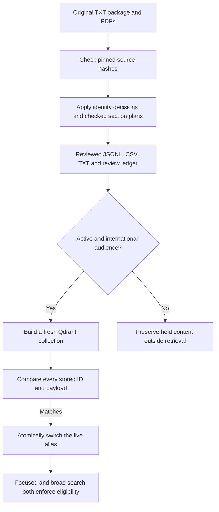

# Applying the flagged-file review

The recommendations were approved on 2026-10-27. The first implementation applies the institution corrections, restores checked source sections, and prevents unresolved content from entering retrieval. **The content review is still in progress.** Processing every ledger entry does not mean every passage has been repaired.

## What changed

The original PDFs and knowledge package remain available for comparison. The builder creates `data/knowledge_reviewed` with matching TXT files, `KNOWLEDGE_INDEX.csv`, and `ALL_RECORDS.jsonl`. The JSONL manifest is the authoritative input to indexing; editing a generated TXT file alone will not change answers.

The four placeholder groups now identify Yeungnam University College, Gachon University, and Kongju National University. Kongju's undergraduate and graduate guides remain separate. The Korean-language-course source now belongs to Ajou University and has a non-degree scope.

Checked replacements include:

- Kongju's actual health-insurance and student-support sections, replacing the retrieval of financial-support forms as insurance evidence.
- Kongju and Gachon admission schedules, with their table columns preserved.
- Kongju, Gachon, and Yeungnam tuition amounts, including source reference years and change notices.
- Kongju and Yeungnam scholarship rows, with eligibility, student category and payment conditions attached.
- Selected Kongju and Hannam program tables, with degree or admission-track headings attached to every row.
- Yeungnam dormitory prices, keeping Happy Dormitory and Global House separate.

The taxonomy now includes the nine topics proposed in the review. A topic label does not itself approve content for retrieval.

## How the new flow works



The application reads the alias `randyll_korea_knowledge_reviewed`. A full indexing run creates a new physical collection, verifies its contents, and then switches this alias. Previous collections, including v3, remain available. Single-file upserts are disabled because they can leave obsolete chunks behind.

Table extraction expands a merged cell only when its actual PDF rectangle covers that row and column. It does not copy the previous value into arbitrary blank cells. Each extracted row retains its headings, source scope and nearby notes. The source plan explicitly lists the sections used; it is not an automatic approval of every detected table.

## Current coverage and limits

The snapshot contains **621 active records**: 323 existing chunks outside the disputed source groups and 298 checked replacement records. **719 original chunks remain held.** These are chunk counts, not the 414 original extracted-record count in the review report, so they should not be compared directly.

Held originals include superseded passages as well as unresolved material. They are retained for tracing and are not all separate outstanding tasks. The `REVIEW_LEDGER.json` file accounts for all 78 reviewed files and links to replacement sections from the same source. Those links do not certify that the entire original file has been reconstructed.

The practical cost is reduced coverage. Search cannot answer from held passages, even if they would otherwise score highly. The baseline active material is marked `baseline_not_fact_checked`; this review does not certify its factual accuracy.

Remaining work includes:

- Reconstruct the remaining program, housing, scholarship, document and contact tables in the four former placeholder groups. Do not reactivate their old flattened text merely because the institution name is now known.
- Split the remaining Hannam graduate consent/navigation material and Tongmyong mixed passages against their full source sections.
- Review KIT, Kunjang and Woosuk by applicant route and source language. Their current material is held source-wide. Kunjang has foreign-applicant content worth recovering; holding it is temporary and is not a decision to discard that source.
- Resolve the remaining Woosong promotional/ranking fragments, and distinguish excluded navigation and blank forms from useful instructions. Incomplete claims stay held.
- Perform answer-quality and multilingual evaluation, and add authoritative material for missing subjects such as employment.

## Hannam graduate programs: R003 completed

The physical PDF page 5 continuation is now reconstructed. The original table parser combined the three degree columns and cut some department names. We checked the rendered PDF and stored a reviewed transcription in `backend/knowledge_review_sections.json`, using the degree headings from page 4.

The replacement contains 22 page-5 department rows. Together with the 26 rows on page 4, their availability markers match the source totals: **45 master's, 42 doctoral and 36 integrated-Ph.D. entries**. These totals count degree offerings, not students or admission quotas.

Two details matter when using the results:

- Biopharmaceutical Engineering appears in two discipline groups. The ordinary engineering entry lists the master's program; the interdisciplinary entry lists the doctoral program. They remain separate.
- Fine Arts lists Painting, Sculpture and Industrial Art for the master's degree, and Fine Art for the Ph.D. The integrated degree has a dash. Its two specialization lines are kept together as one department record.

Each page-5 record includes the source's program-duration and English-lecture notes. The English-lecture list is not treated as proof that an entire degree is taught in English. Blank specialization cells remain blank, and the TOTAL row is not indexed as a department.

The review ledger marks R003 as `reconstructed_original_held` and links to both replacement pages. The old `Other_Policies` extraction remains held; this is why the held count does not fall when the replacement is added. The undergraduate GPA and appendix follow-up is documented below.

## Hannam undergraduate appendices: R004 and R005 completed

The mixed undergraduate files are now reconstructed as separate, source-specific passages. This pass adds **68 checked records**:

| Source page | Correction | Records |
|---|---|---:|
| 4 | Academic eligibility, preserving school-system exceptions | 1 |
| 7 and 9 | Complete document-verification conditions and submission notes | 2 |
| 10 | Apostille appendix, with its July 9, 2026 reference date and region headings | 5 |
| 11 | Overseas Korean school list, with its April 1, 2025 reference date and country headings | 16 |
| 16 and 19 | Complete declarations from application Form 1 and educational-history Form 4 | 2 |
| 17 | Consent Form 2 instructions, connected to the academic-verification purpose | 1 |
| 20 | GPA conversion rows with all five scale headings attached | 41 |

Use the GPA table as a reference from this Hannam guide. It maps the 4.0, 4.3, 4.5 and 7.0 scales to scores from 100 down to 60. Keep the printed ranges; do not interpolate a new conversion formula or infer an admission or scholarship threshold. The final row uses the Korean term `??`, meaning **at or below**, including the boundary value.

The Apostille and school lists remain dated references from the local document. They are not a current membership check or a nationality-eligibility rule. The school list retains the source's truncated spelling `Konkuk Korean Schoo` and identifies it as a source spelling rather than silently inventing a correction.

The existing `Documents_Verification.txt` also contained partial paragraphs and a detached country list. Its five chunks are now held, with complete replacements from pages 7, 9 and 10. The new text keeps the graduation-certificate and transcript requirements together, including the translation exception, China-specific verification alternative and overseas-Korean-school exemption. The page 9 continuation restores the March 2027 deadline and the consequence stated by the source.

The form records contain instructions and declarations, not empty applicant fields. Form 4's English declaration is restored from its opening words through the closing clause. Its Korean text also mentions degree cancellation, while its English declaration mentions admission; the record explicitly preserves that distinction. The separate, inconsistently translated attendance-rounding instruction is not released as a new rule in this pass.

The review ledger marks R004 and R005 as `reconstructed_original_held`. Their originals remain available for tracing. This completes the recommendations for these two flagged files, not a factual certification of every section in the Hannam guide.

## Rebuild after making a correction

Use the Python installation with PyMuPDF for the package build and the project's environment with BGE-M3 and Qdrant support for indexing. On this workstation:

```powershell
python backend/review_knowledge.py
.\.venv\Scripts\python.exe backend/index_knowledge.py --audit
.\.venv\Scripts\python.exe -m unittest test.test_knowledge_domains test.test_knowledge_review
.\.venv\Scripts\python.exe backend/index_knowledge.py
```

The builder requires the local source package and PDFs. They are ignored by Git; a fresh checkout alone does not contain the knowledge data. The checked extraction plan and source hashes are version controlled in `backend/knowledge_review_sections.json` and `backend/knowledge_review_source_hashes.json`.

If a pinned source changes, the builder stops. Open the changed PDF, verify the relevant section and table layout, update the extraction plan, and only then update its hash. A hash mismatch should not be bypassed by blindly regenerating hashes.

For the next review pass, add a checked section plan, inspect its generated passages against the source, rerun the checks, and rebuild. Preserve degree, applicant route, language track, currency, dates and footnotes. Keep unresolved sections held and record why. Consult `REVIEW_LEDGER.json`, not just the active-record audit: an empty active review queue does not mean held content is complete.

## Verification

Twenty-two regression tests pass. They cover the existing domain behavior, exclusion during broad and focused retrieval, merged-cell handling, all 78 ledger entries, insurance source pages, and the corrected dormitory associations. Live indexing compares every ID and complete payload before promoting the collection.

The initial live verification on 2026-10-27 checked `randyll_korea_knowledge_v4_20261027_064813`, containing 536 records and six keyword indexes. Stored IDs and payloads match the package; PDF crop coordinates are compared to six decimal places to tolerate JSON float formatting. All evidence text and other metadata are compared exactly. Broad, inferred-domain and strict-finance searches returned only eligible records, and strict employment search returned no results. These checks used a stored vector and establish retrieval mechanics, not answer quality. The previous v3 collection still contains its 1,042 records.

After the Hannam R003 correction, the live alias was promoted to `randyll_korea_knowledge_v4_20261027_071220` with **558 verified records**. All 22 page-5 records are present and eligible for retrieval. A strict education-domain query using a stored Hannam vector returned the expected source record. The previous 536-record collection remains available. The package rebuild is deterministic, pinned source hashes still match, and all 19 regression tests pass.

After the Hannam R004/R005 corrections, the live alias was promoted to `randyll_korea_knowledge_v4_20261027_072336` with **621 verified records**. All 68 new records are present, including all 41 GPA rows. Strict education-domain and broad retrieval using a stored GPA vector returned the expected record; the five superseded verification fragments are absent. The previous 558-record collection is preserved. All 22 regression tests pass, and rebuilding the package produces identical output with unchanged source hashes. These are source-structure and retrieval checks, not an end-to-end answer-quality benchmark.

No end-to-end chatbot or paid LLM evaluation is included. The previously recorded PostgreSQL schema/data and local driver prerequisites still apply. The local source checks also do not establish that each PDF is the latest official publication.
