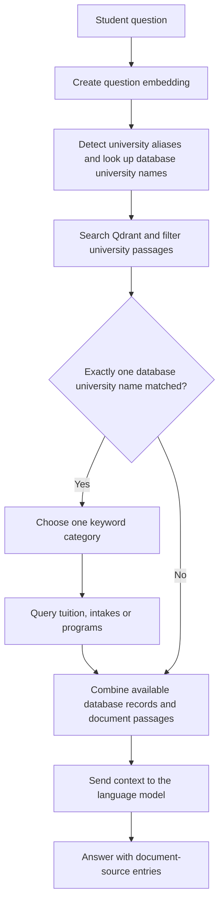

# Improvement #2: Structured data alongside embeddings

**Status: partially implemented.** Reviewed on 2026-10-27. The interns added PostgreSQL query functions and connected their results to the RAG prompt. The current local setup does not yet have the required database tables or Python driver, and the filtering and comparison capabilities described in the technical improvement strategy remain unfinished.

This document records what exists, what was verified, and what still needs to be delivered. It does not mark the improvement complete or change the database. The remaining Improvement #1 content reviews are being left for the interns.

## What this improvement should provide

Keep explanatory passages, university rules and guides in Qdrant. Store facts that need exact filtering in PostgreSQL: universities, locations, programs, degrees, teaching languages, tuition, intakes and eligibility, together with their sources and verification dates.

For example, a question such as “Find English-taught computer science master's programs in Seoul costing less than 10 million KRW per year” needs several filters and a consistent annual tuition calculation. Finding a related paragraph is only part of that task.

## What the interns implemented

| File | Existing implementation | Practical value |
|---|---|---|
| [backend/db.py](../backend/db.py) | PostgreSQL connection settings from the environment; functions for universities, programs, tuition and intakes; parameterized SQL | Provides the application-side database access layer |
| [backend/structured_retrieval.py](../backend/structured_retrieval.py) | English keyword routing to one record category; JSON formatting for database values, including dates and decimals | Turns database query results into text the language model can use |
| [backend/rag.py](../backend/rag.py) | Looks for a database university name in the question, retrieves structured records, and combines them with Qdrant passages | Establishes a basic combined document-and-database answer flow |
| [test_postgres.py](../test_postgres.py) | Prints universities and Gachon program, tuition and intake query results | Provides a manual connection and query smoke check |

The program query selects degree level, language track, admission type, transfer entry year and campus name. The tuition query selects amount, currency, billing period and effective year. The intake query selects academic year, semester, round, status and application dates converted to Korean time. These are useful starting fields, but selecting a field is not the same as implementing a filter for it.

These files were introduced in commit `ec9fa6f` (`feat: add PostgreSQL database schema and connection`). Despite that title, the commit contains four Python files and no database schema script. The current Compose setup was added during the later project-polishing work; it is separate from the interns' original query integration.

## How the current code works

This diagram describes the code path, not a successful end-to-end run in the current environment. The structured lookup currently requires one normalized full database university name to appear in the question. The aliases used for document retrieval are not used to resolve the structured lookup in the same way.

The category checks run in this order: tuition/fee/cost, then deadline/intake/application date, then program/course/degree/major. Because they use `if` followed by `elif`, only one category is selected. For example, “Gachon University tuition and deadlines” requests tuition records but not intake records.

## What was verified locally

| Check | Finding |
|---|---|
| PostgreSQL schema inspection | Only the `public` schema was found among application schemas. The expected `university`, `financial` and `admissions` schemas and tables were absent. |
| Project `.venv` | `psycopg` was not installed. It is imported when the database module loads, so this can stop backend import before runtime database-error handling is reached. |
| Schema and data deliverables | No SQL schema, migration, seed, `.dump` or `.backup` files were found in the inspected workspace, excluding `.mypersonal`. |
| Manual test script | It prints results but does not assert expected record counts or correct values. Successful execution alone would not establish that the data is complete. |
| End-to-end structured answers | Not verified. The missing driver and application tables prevent that check in this setup. |

The interns may have created and populated PostgreSQL separately on their own machines. The local findings do not prove that no such database exists elsewhere. Ask for their schema and data export before rebuilding their database design from scratch.

## What is missing or incomplete

| Area | Current limitation | What is needed |
|---|---|---|
| Repeatable database setup | Query code expects tables that are not delivered locally | Schema migrations or an importable schema, approved seed data, and setup instructions |
| Data ingestion and maintenance | No repeatable structured-data import/update workflow was found | Extract, normalize, verify and update records with a traceable source |
| Exact filtering | Queries filter by university name; they do not accept city, budget, degree or teaching-language constraints | Structured query parameters and SQL filters for the intended student searches |
| Comparable costs | Billing period is returned, but semester-to-year normalization is absent | Explicit period rules and deterministic calculations using verified amounts |
| Multi-category questions | Keyword routing selects only one category | Retrieve all relevant categories when a question needs them |
| University discovery and comparison | Structured retrieval depends on exactly one full university-name match | Consistent institution resolution, searches without a named university, and multi-university comparisons |
| Date and intake scope | Tuition and intake queries return rows across years/rounds without question-specific filtering | Explicit requested-year, intake and applicable-record selection |
| Sources and verification | Structured query results do not include source references or verification dates; the returned source list is built from Qdrant results | Record-level provenance and citations for structured facts |
| Conflicting evidence | PostgreSQL and Qdrant text are concatenated without an explicit conflict-resolution step | Detect differences and choose evidence according to documented scope, dates and verification status |
| Independent structured answers | Embedding or Qdrant errors return early, before the structured context can provide an answer | Allow suitable structured questions to work independently of semantic retrieval |
| Validation | There is a manual print-based smoke script, but no delivered correctness suite for structured answers | Assertions for filters, amounts, dates, empty results, comparisons and provenance |

No structured eligibility lookup is implemented in the inspected database access module. The intended eligibility coverage from the strategy still needs to be defined and delivered.

## What to request from the interns next

1. Provide the database schema and a data export, or the migration and import scripts used to build it. Include the PostgreSQL version and restore instructions, without sharing passwords in the document.
2. Explain which universities and intakes are populated, which source documents support the records, and when those records were checked.
3. Demonstrate a single-university query using their existing code, then show which parts of the strategy's multi-filter example are supported today.
4. Identify manual data-entry steps and provide a repeatable way to update or correct the records.

Once those deliverables are available, inspect them against the existing Python queries. Then restore the database, install the project driver, verify representative records, and implement the missing behavior in small steps.

## When this improvement can be marked complete

Do not close the step merely because PostgreSQL connects. A fresh setup should be reproducible, representative records should match their sources, and the application should answer single-university questions and the strategy's multi-filter comparison example correctly. Costs must use a consistent period, applicable years and intakes must remain clear, and structured facts must carry usable source references. Record the tests and any remaining limitations before marking completion.
